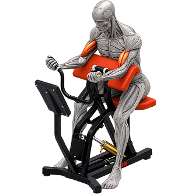

# 💪 FitLog — Workout Library



**FitLog** is a dark, no-nonsense gym companion: pick a lift, lock it into today's plan, and watch the week's work add up. Browse a library of twelve lifts covering every major muscle group, dig into each one's specs and instructions, and build a capped five-lift plan for the day.

## 🔗 Links

- **Live Link:** https://fit-log-psi-tan.vercel.app/
- **GitHub Repository:** https://github.com/Tahera-b14/FitLog

## 🛠️ Technologies Used

| Technology | Purpose |
| --- | --- |
| [Next.js 15](https://nextjs.org/) (App Router) | UI and page routing |
| [React 19](https://react.dev/) | Components and state (Context API) |
| [Tailwind CSS 4](https://tailwindcss.com/) | Styling and responsive layout |
| [lucide-react](https://lucide.dev/) | Icons |
| [react-hot-toast](https://react-hot-toast.com/) | Toast notifications |
| FitLog API | Workout data (`/api/fitlog`, `/api/fitlog/:id`) with an automatic fallback API |

## ✨ Key Features

1. **Workout library** — all twelve workouts in a responsive 3×4 grid with images, muscle-group tags, equipment and duration / calorie / rating stats.
2. **Sort and search** — re-sort the library by Duration, Calories or Rating, and filter by workout name or tag.
3. **Detailed workout pages** — two-column layout with a key-specs panel (equipment, difficulty, sets, reps, duration, calories, rating) and numbered instructions.
4. **Today's Plan & Saved lists** — add lifts to today's plan (capped at five) or save them for later; navbar badges update instantly and every action shows a toast.
5. **My Plan dashboard** — live Exercises / Minutes / Calories metrics, tabs, Mark as Done, remove, and a friendly empty state.
6. **Persistent progress** — plan and saved lists are stored in `localStorage`, so they survive page reloads.
7. **Fully responsive** — works on mobile, tablet and desktop, with a collapsible mobile menu, loading animations and a custom 404 page.

## 🚀 Getting Started

```bash
npm install
npm run dev
```

Then open [http://localhost:3000](http://localhost:3000).

To build for production:

```bash
npm run build
npm start
```

## 📁 Project Structure

```
app/
  layout.js            Root layout: fonts, navbar, footer, toasts, plan provider
  page.js              Home: hero + library
  workout/[id]/page.js Workout detail page
  my-plan/page.js      My Plan page (Today's Plan / Saved)
  not-found.js         404 page
components/            Navbar, Footer, Hero, Library, cards, sort dropdown, plan context
lib/api.js             API helpers with fallback
public/                Logo and banner images
```
